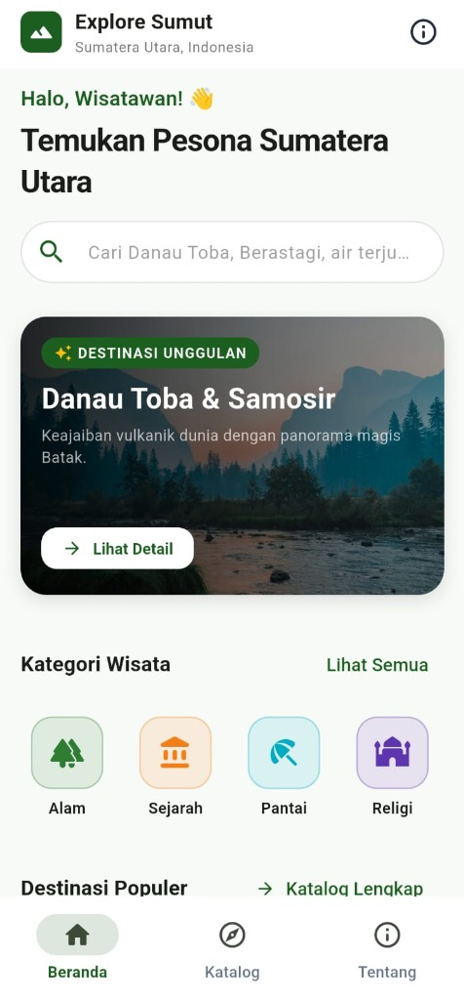
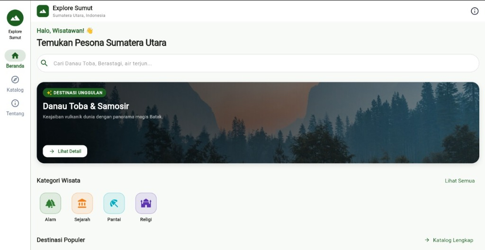

# Explore Sumut — Aplikasi Panduan Wisata Sumatera Utara

[](https://flutter.dev)
[](https://dart.dev)
[](https://pub.dev/packages/go_router)
[](https://m3.material.io/)
[](https://opensource.org/licenses/MIT)

Aplikasi panduan wisata Sumatera Utara berbasis Flutter yang dirancang dengan **desain responsif**, **navigasi deklaratif multi-screen (`go_router`)**, dan **Clean Architecture**. Proyek ini dibangun untuk memenuhi **Tugas Rutin 6** mata kuliah Pemrograman Mobile pada Program Studi Ilmu Komputer, Universitas Negeri Medan.

---

## 1. Identitas Mahasiswa & Tugas

Bagian identitas ini dapat disesuaikan untuk pengumpulan tugas:

- **Nama**: Bryant Tinambunan
- **NIM**: 4241250015
- **Kelas**: PSIK 24D
- **Program Studi**: Ilmu Komputer
- **Fakultas**: Fakultas Matematika dan Ilmu Pengetahuan Alam (FMIPA)
- **Universitas**: Universitas Negeri Medan (UNIMED)
- **Mata Kuliah**: Pemrograman Mobile (3KOM40215 - 3 SKS)
- **Pertemuan**: Pertemuan 6 (Layout Responsif dan Navigasi Multi-Screen di Flutter)
- **Dosen Pengampu**: Adidtya Perdana, S.T., M.Kom.

---

## 2. Tujuan Aplikasi

Explore Sumut bertujuan untuk:
1. Menyediakan panduan digital informasi destinasi wisata unggulan di Sumatera Utara (Danau Toba, Bukit Lawang, Berastagi, Istana Maimun, Air Terjun Sipiso-piso, Pantai Pandan, Tangkahan, Masjid Raya Al-Mashun, dll.).
2. Menghadirkan antarmuka adaptif yang nyaman digunakan di berbagai ukuran layar: smartphone Android, tablet, hingga web desktop.
3. Mengimplementasikan navigasi deklaratif multi-screen menggunakan `go_router` dengan `StatefulShellRoute` untuk menjaga state halaman antar-tab.
4. Menerapkan 10 widget wajib Flutter: `Row`, `Column`, `Stack`, `Positioned`, `Expanded`, `Flexible`, `LayoutBuilder`, `MediaQuery.sizeOf(context)`, `GridView.builder`, dan `ListView`.

---

## 3. Fitur Utama

- **Splash Screen**: Layar pembuka animasi interaktif dengan logo Explore Sumut dan transisi otomatis.
- **Beranda (Home)**:
  - Header sapaan dan headline Sumatera Utara.
  - Quick Search bar menuju katalog.
  - Banner destinasi unggulan dengan gradien visual bertumpuk (`Stack` & `Positioned`).
  - Akses cepat kategori wisata tematik (Alam, Sejarah, Pantai, Religi).
  - Daftar destinasi terpopuler berperingkat tinggi.
- **Katalog Wisata (Catalog)**:
  - Grid responsif adaptif (`LayoutBuilder`: 2 kolom pada ponsel, 3 kolom pada tablet portrait, 4 kolom pada tablet landscape/desktop).
  - Filter pencarian teks langsung (live filter) berdasarkan nama, kabupaten/kota, atau deskripsi.
  - Filter kategori berbasis `FilterChip` interaktif.
  - Indikator jumlah wisata dan Empty State ketika pencarian tidak ditemukan.
- **Detail Wisata (Detail)**:
  - Navigasi rute dinamis dengan path parameter `/detail/:id`.
  - Transisi gambar mulus menggunakan animasi `Hero`.
  - Layout dua mode adaptif: susunan vertikal (`ListView`) pada layar sempit (< 700 dp) dan susunan berdampingan (`Row` & `Expanded`) pada layar lebar (≥ 700 dp).
  - Penanganan ID tidak dikenal melalui halaman *Destinasi Tidak Ditemukan*.
  - Rincian harga tiket (format rupiah otomatis atau label *Gratis*), jam buka, lokasi alamat, deskripsi lengkap, serta fasilitas.
- **Kategori Wisata (Category Route)**:
  - Menampilkan wisata per kategori pada path `/kategori/:nama`.
- **Tentang Aplikasi (About)**:
  - Header bertumpuk bergaya Material 3 (`Stack`).
  - Status deteksi dimensi layar real-time (*Window Size Class* & lebar dp saat ini).
  - Profil lengkap pengembang, program studi, dan universitas.

---

## 4. Penjelasan Keputusan Desain Responsif (172 Kata)

> Penerapan layout responsif pada aplikasi Explore Sumut menggunakan pendekatan dua lapis dengan kombinasi `MediaQuery.sizeOf(context)` dan `LayoutBuilder`. `MediaQuery.sizeOf(context)` difungsikan untuk keputusan navigasi makro pada tingkat aplikasi dengan batas breakpoint 840 dp. Pada lebar layar di bawah 840 dp (smartphone), aplikasi menampilkan `NavigationBar` di sisi bawah layar untuk kemudahan jangkauan satu tangan (*thumb-friendly*). Sebaliknya, pada lebar 840 dp ke atas (tablet/desktop), tata letak beralih ke `NavigationRail` di sisi samping kiri dengan `Row` dan `Expanded` agar memanfaatkan ruang horizontal secara optimal.
>
> Untuk keputusan tata letak komponen mikro, aplikasi memanfaatkan `LayoutBuilder` yang membaca batas ruang lokal (`constraints.maxWidth`). Pada Halaman Katalog, `LayoutBuilder` menentukan jumlah kolom `GridView` secara dinamis: 2 kolom untuk lebar di bawah 600 dp, 3 kolom untuk 600–899 dp, dan 4 kolom untuk 900 dp ke atas. Pada Halaman Detail, batas 700 dp digunakan untuk beralih dari susunan `ListView` vertikal menjadi `Row` horizontal berdampingan antara gambar dan informasi. Risiko *RenderFlex overflow* dieliminasi secara menyeluruh dengan membungkus teks panjang menggunakan `Expanded`, `Flexible`, dan `TextOverflow.ellipsis`, serta memanfaatkan `SingleChildScrollView`.

---

## 5. Struktur Folder Proyek

```text
pm_p6_4241250015/
├── android/                   # Konfigurasi native Android
├── assets/
│   ├── icons/                 # Aset ikon aplikasi
│   └── images/                # Foto destinasi wisata Sumatera Utara
├── docs/
│   └── screenshots/           # Tangkapan layar pengujian aplikasi
├── lib/
│   ├── data/
│   │   └── destination_data.dart   # Data master 8+ destinasi & fungsi filter
│   ├── models/
│   │   └── destination.dart        # Model class Destination & properti
│   ├── routes/
│   │   └── app_router.dart         # Konfigurasi deklaratif go_router
│   ├── screens/
│   │   ├── about_screen.dart       # Halaman Tentang & profil mahasiswa
│   │   ├── catalog_screen.dart     # Halaman Katalog (Grid responsif LayoutBuilder)
│   │   ├── category_screen.dart    # Halaman Filter Kategori (/kategori/:nama)
│   │   ├── detail_screen.dart      # Halaman Detail (Responsif vertikal/horizontal)
│   │   ├── home_screen.dart        # Halaman Beranda (Banner, Kategori, Populer)
│   │   ├── not_found_screen.dart   # Halaman fallback 404 / ID tidak dikenal
│   │   └── splash_screen.dart      # Layar pembuka animasi
│   ├── utils/
│   │   ├── app_constants.dart      # Konstanta teks, identitas, & breakpoint
│   │   ├── app_theme.dart          # Tema Material 3 nuansa alam Sumatera
│   │   └── format_helper.dart      # Extension format mata uang Rupiah
│   ├── widgets/
│   │   ├── category_chip.dart      # Widget filter chip kategori
│   │   ├── destination_card.dart   # Widget kartu wisata (Stack, Hero, InkWell)
│   │   ├── featured_banner.dart    # Widget banner hero beranda
│   │   ├── responsive_navigation.dart # Scaffold adaptif NavigationBar / Rail
│   │   └── search_field.dart       # Widget textfield pencarian
│   ├── app.dart               # Root MaterialApp.router
│   └── main.dart              # Titik masuk utama aplikasi (main entrypoint)
├── test/
│   └── widget_test.dart       # Test suite komprehensif (Unit, Widget, Breakpoints)
├── pubspec.yaml               # Dependensi & registrasi aset lokal
└── README.md                  # Dokumentasi proyek & panduan pengujian
```

---

## 6. Implementasi 10 Widget Wajib Flutter

| No | Widget / Teknik | Lokasi Implementasi Utama | Fungsi Nyata dalam Aplikasi |
|---|---|---|---|
| 1 | `Row` | `DestinationCard`, `HomeScreen`, `DetailScreen` | Menyusun ikon rating, lokasi, tombol aksi, serta layout berdampingan di layar lebar |
| 2 | `Column` | `DestinationCard`, `DetailScreen`, `HomeScreen` | Menyusun hierarki teks judul, subtitle, detail harga, dan deskripsi secara vertikal |
| 3 | `Stack` | `DestinationCard`, `FeaturedBanner`, `DetailScreen`, `AboutScreen` | Menumpuk teks headline, badge kategori, dan rating di atas gambar destinasi |
| 4 | `Positioned` | `DestinationCard`, `FeaturedBanner`, `DetailScreen`, `AboutScreen` | Mengatur penempatan presisi badge kategori, rating, dan tombol aksi di sudut gambar |
| 5 | `Expanded` | `ResponsiveNavigationScaffold`, `DetailScreen`, `DestinationCard` | Membagi ruang proporsional antara NavigationRail dan konten shell, serta layout detail side-by-side |
| 6 | `Flexible` | `FeaturedBanner`, `DestinationCard` | Memberikan elastisitas pada teks dan kontainer teks agar tidak memaksakan ukuran tetap |
| 7 | `LayoutBuilder` | `CatalogScreen`, `CategoryScreen`, `DetailScreen`, `HomeScreen` | Menghitung lebar aktual untuk menentukan jumlah kolom grid (2, 3, atau 4) dan susunan detail |
| 8 | `MediaQuery.sizeOf(context)` | `ResponsiveNavigationScaffold`, `AboutScreen` | Mengambil lebar viewport untuk beralih antara `NavigationBar` (< 840 dp) dan `NavigationRail` (≥ 840 dp) |
| 9 | `GridView.builder` | `CatalogScreen`, `CategoryScreen`, `HomeScreen` | Merender daftar kartu destinasi secara dinamis dan hemat memori (*lazy loading*) |
| 10 | `ListView` | `HomeScreen`, `AboutScreen`, `DetailScreen` (mobile) | Menyediakan kanvas scrollable vertikal yang mulus untuk konten teks dan media |

---

## 7. Tangkapan Layar Aplikasi (Screenshots)

Berikut adalah bukti tangkapan layar pengujian antarmuka responsif dan navigasi multi-screen pada aplikasi **Explore Sumut**:

### A. Perbandingan Tampilan Beranda & Navigasi Adaptif

| Tampilan Ponsel (Mobile - Lebar < 840 dp) | Tampilan Tablet (Tablet/Desktop - Lebar ≥ 840 dp) |
| :---: | :---: |
|  |  |
| **Ponsel**: `NavigationBar` di sisi bawah, tampilan kompak vertikal | **Tablet**: `NavigationRail` di samping kiri, pemanfaatan ruang horizontal |

---

### B. Matriks Pengujian Responsivitas

| No | Halaman & Perangkat | File Tangkapan Layar | Status Pengujian & Perilaku Layout |
|:---:|---|---|---|
| 1 | **Halaman Beranda / Daftar (Ponsel)** | [`docs/screenshots/mobile_home.jpg`](docs/screenshots/mobile_home.jpg) | ✅ **Teruji**: `NavigationBar` di bawah, bebas overflow, banner proporsional |
| 2 | **Halaman Beranda / Daftar (Tablet)** | [`docs/screenshots/tablet_home.jpg`](docs/screenshots/tablet_home.jpg) | ✅ **Teruji**: `NavigationRail` di samping kiri, tata letak melebar adaptif |
| 3 | **Halaman Detail Wisata (Ponsel)** | [`docs/screenshots/mobile_detail.jpg`](docs/screenshots/mobile_detail.jpg) | ✅ **Teruji**: Susunan vertikal (`ListView`), gambar di atas dan info di bawah |
| 4 | **Halaman Detail Wisata (Tablet)** | [`docs/screenshots/tablet_detail.jpg`](docs/screenshots/tablet_detail.jpg) | ✅ **Teruji**: Susunan horizontal berdampingan (`Row` & `Expanded`) |

---

## 8. Panduan Instalasi dan Menjalankan Aplikasi

### Prasyarat
- Flutter SDK versi 3.24 ke atas (diuji pada Flutter 3.47.8 / Dart 3.13.7)
- Android Studio / VS Code dengan ekstensi Flutter & Dart
- Emulator Android Smartphone & Tablet, atau Google Chrome

### Langkah Menjalankan Proyek

1. **Buka Terminal / PowerShell di direktori proyek**:
   ```powershell
   cd d:\PM\pm_p6_4241250015
   ```

2. **Unduh dependensi pub**:
   ```powershell
   flutter pub get
   ```

3. **Periksa integritas kode dengan static analysis**:
   ```powershell
   flutter analyze
   ```
   *(Hasil: `No issues found!`)*

4. **Jalankan unit test dan responsive widget test**:
   ```powershell
   flutter test
   ```
   *(Hasil: `All tests passed!`)*

5. **Jalankan aplikasi di perangkat target**:
   - Menjalankan di Google Chrome (mudah mengubah ukuran jendela browser untuk menguji responsivitas):
     ```powershell
     flutter run -d chrome
     ```
   - Menjalankan di Emulator Android Smartphone:
     ```powershell
     flutter run -d <nama_device_ponsel>
     ```
   - Menjalankan di Emulator Android Tablet:
     ```powershell
     flutter run -d <nama_device_tablet>
     ```

6. **Pengujian Pengujian Khusus**:
   - **Deep Link Sukses**: Buka URL `http://localhost:<port>/#/detail/1` (menampilkan Danau Toba).
   - **Deep Link 404 / ID Tidak Dikenal**: Buka URL `http://localhost:<port>/#/detail/999` (menampilkan pesan *Destinasi Tidak Ditemukan* dan tombol navigasi kembali).
   - **Pengujian Responsivitas**: Geser tepi jendela browser Chrome dari 360 dp hingga 1280 dp untuk melihat pergantian halus antara NavigationBar ke NavigationRail serta 2 kolom, 3 kolom, dan 4 kolom grid.

---

## 9. Pernyataan Penggunaan AI

Pengembangan aplikasi ini dibantu oleh asisten AI (Google DeepMind Antigravity) untuk membantu perancangan arsitektur modul, penerapan linting best-practice Flutter, pengujian unit test responsivitas multi-screen, dan penyusunan dokumentasi teknis.
